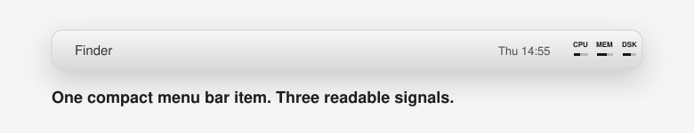
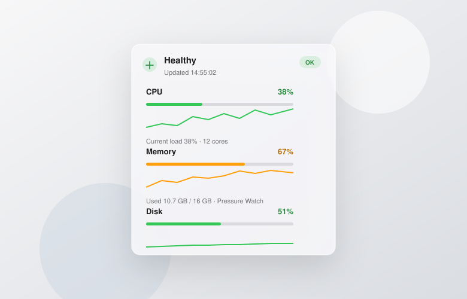

# CoreBar

[中文说明](README.zh-CN.md)

CoreBar is a quiet macOS menu bar monitor for CPU, memory, disk, and network activity. It stays compact in the menu bar, keeps its background presence light, and shows exact numbers only when you click.



## What It Shows

- CPU, memory, and disk usage in one native menu bar item.
- Compact labels with slim usage bars, tuned for light and dark mode.
- Current download and upload speed in the detail panel.
- Classic list and Cards panels, with a direct return from settings to usage.
- Opaque panel backgrounds in light mode, system glass in dark mode, and neutral native settings controls in both appearances.
- On macOS 26 and later, Classic and Cards share one native glass surface, with an in-place return from settings and no extra window shadow around the rounded edge. Classic keeps its continuous data list; macOS 14–15 retain the original popover presentation.
- A settings window for launch at login, refresh interval, visible metrics, panel style, and threshold colors.
- Card overviews resize with visible metrics. Overall health includes hidden CPU, memory, and disk metrics, and marks a hidden alert source explicitly.
- Capacity details remain readable; network rates identify combined traffic, and chart help describes the latest 30 samples and automatic network scaling.
- A detail panel with exact used, free, and total values.
- Disk details prioritize home and external volume capacities, identify the home volume by name, and keep a smaller home-volume history below the capacity list.
- Disk details list mounted local external volumes with names, paths and capacity, including separate partitions. Mount changes refresh on the next sample; capacity is cached up to 60 seconds. The overview and overall alerts still refer to the home volume. Detail scroll indicators are hidden; scrolling remains available.
- Thin CPU/network trend lines and calibrated memory/disk capacity bars. Hover over a trend or use arrow keys to inspect samples.
- Click a metric or its chevron for recent history, average and peak values, and explanations; return with Back to Usage or ⌘[. Network details show download and upload separately.
- Automatic English or Chinese UI based on your system language.
- Local-only system readings. No account, tracking, or cloud service.



The panel labels the memory metric **Memory** and its main percentage **Estimated pressure**, calculated from system page statistics rather than Activity Monitor's pressure signal. The capacity bar and its percentage show used memory divided by physical memory, independently of pressure. Network rates include active non-loopback interfaces, including virtual interfaces. Trends retain the latest 30 samples with actual timestamps, so their displayed time span reflects interval changes and sampling gaps. Disk capacity readings are cached for up to 60 seconds.

## Why CoreBar

CoreBar is for people who want a quick system signal without opening Activity Monitor. It is small enough to leave running all day, with the detail hidden until you need it.

## Download

Download the latest macOS build from [GitHub Releases](https://github.com/MightyKartz/CoreBar/releases/latest).

Release builds are Developer ID signed, but they are not notarized yet. If macOS blocks the app on first launch, right-click the app and choose **Open**, or build it from source.

## Build From Source

Requirements:

- The app runs on macOS 14 or later.
- Building requires Xcode 26 or later with the macOS 26 SDK and its bundled Swift toolchain, selected with `xcode-select`. Standalone older Command Line Tools are insufficient for the Liquid Glass APIs.
- Development is currently verified with Xcode 26.6.

Run locally:

```bash
swift test
./script/build_and_run.sh
```

The script builds the Xcode app target, including its icon, Info.plist and sandbox entitlements. Local builds default to Debug with an ad hoc signature. SwiftPM remains available for fast unit tests.

Build without stopping or launching the app:

```bash
./script/build_and_run.sh --build-only
```

Build a Release app bundle when a Developer ID identity exists:

```bash
CONFIGURATION=Release DEVELOPMENT_TEAM="TEAMID" CODESIGN_IDENTITY="Developer ID Application: Your Name (TEAMID)" ./script/build_and_run.sh --build-only
```

The app bundle is written to `dist/CoreBar.app`. Version and build number come from the Xcode project; `VERSION` and `BUILD_NUMBER` can override them. `DIST_DIR` and `DERIVED_DATA_DIR` can redirect the output and build cache. Relative paths are resolved from the repository root, and the script can be invoked from any working directory.

All builds use the project's sandbox entitlements. Developer ID builds use hardened runtime and request a secure signing timestamp; the script does not submit the app for notarization.

The default run builds and validates the new bundle before replacing and restarting the app. `--debug`, `--logs`, `--telemetry` and `--verify` retain their debugger, log stream and launch-check workflows.

## Privacy

CoreBar reads local system statistics only. It does not send data anywhere.
